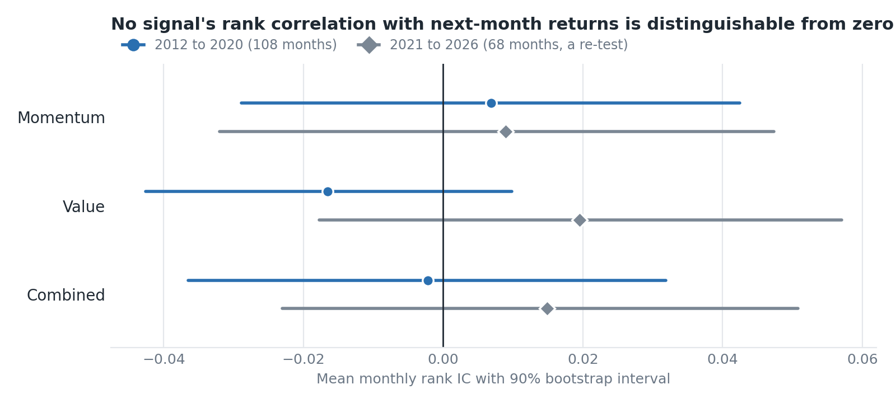
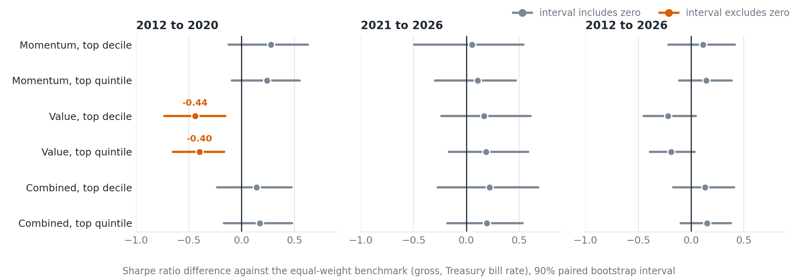

# Equity Factor Research: do momentum and value predict stock returns?

[](https://github.com/ronaldoexmachina13/quant-equity-research/actions/workflows/tests.yml)

*Do simple momentum and value signals predict next-month returns among large US stocks, and do portfolios built from them beat an equal-weight benchmark?*

**Status: complete. No further development is planned.** [Live dashboard (17-stock study)](https://ronaldoexmachina13.github.io/quant-equity-research/)

> **Correction (7 November 2026):** Value results in the first, 17-stock study are overstated. Price-to-book was too low for stocks that split their shares. With splits handled, in-sample Value Sharpe is about 0.61, not 0.86, below the benchmark's 0.81. See [the corrections table](#corrections-found-by-the-project-itself).

## Bottom line

On about 500 S&P 500 stocks from 2012 to 2026, none of the three signals showed a statistically detectable relationship with next-month returns in the primary tests. With 108 months in the first test period, the test could only have detected a mean rank correlation of about 0.055 or more, so the result means "not enough evidence", not "no effect". The data is free and survivor-biased, so differences between portfolios are worth reading and return levels are not.

## Headline findings

| Test | 2012 to 2020 | 2021 to 2026 | Reading |
|---|---:|---:|---|
| Momentum: mean rank IC | +0.007 (-0.029 to +0.042) | +0.009 (-0.032 to +0.047) | Interval includes zero in both periods |
| Value: mean rank IC | -0.017 (-0.043 to +0.010) | +0.020 (-0.018 to +0.057) | Interval includes zero in both periods |
| Combined: mean rank IC | -0.002 (-0.036 to +0.032) | +0.015 (-0.023 to +0.051) | Interval includes zero in both periods |
| Momentum: Sharpe difference against benchmark, top decile | +0.28 (-0.12 to +0.63) | +0.06 (-0.50 to +0.54) | Interval includes zero in both periods |
| Value: Sharpe difference against benchmark, top decile | **-0.44 (-0.73 to -0.15)** | +0.17 (-0.24 to +0.61) | **Interval excludes zero in 2012 to 2020 only**; the headline signal tests include zero, some sensitivities lean the same way |
| Combined: Sharpe difference against benchmark, top decile | +0.14 (-0.23 to +0.48) | +0.22 (-0.27 to +0.68) | Interval includes zero in both periods |

Intervals are 90% bootstrap intervals (5,000 resamples). IC is the rank information coefficient: the monthly Spearman correlation between a signal and the next month's return. The 2021 to 2026 months were already known from the first study, so they are a re-test and not out-of-sample evidence. Quintile spreads, Fama-MacBeth regressions and the top-quintile portfolios are in `results/`.



### What stands out: Value, 2012 to 2020

Two of the 18 headline portfolio comparisons have intervals that exclude zero, both for Value in 2012 to 2020 (top decile and top quintile). They are one finding measured twice, because the portfolios overlap. About two of 18 intervals would exclude zero by chance alone. The re-test and the full period do not show it.

The headline rank IC, quintile spread and Fama-MacBeth intervals for Value in 2012 to 2020 include zero. Its Fama-MacBeth slope for the same period falls just below zero under three secondary sensitivities (winsorised P/B, and with the 24 or 37 suspect names excluded). These tests share the same months and stocks, so they are not independent evidence. I report them as found and have not tested an explanation.



Portfolios hold the top decile or top quintile of names by signal, equal weight, rebalanced monthly, with 10 bps one-way costs. Charging costs does not change which intervals include zero. Excluding the 24 or 37 suspect names changes the Value and Combined point estimates slightly and the same two Value intervals still exclude zero.

## Why these signals

Momentum (the return from 12 months ago to one month ago) is a long-documented effect that may reflect slow reaction to news. Value (a low price-to-book ratio) may compensate for risk or reflect over-pessimism. Neither is expected to be large among liquid, heavily analysed large caps, so a null result is a plausible outcome.

## Data

- **Universe:** S&P 500 membership rebuilt month by month from Wikipedia. Between 353 and 499 names are usable for Momentum each month, and between 295 and 426 for Value and Combined.
- **Sources (all free):** prices from Yahoo Finance (`yfinance`), book value from SEC EDGAR filings aligned to filing dates, Treasury bill rates from FRED.
- **Survivorship:** companies that were acquired or went bankrupt mostly have no price history, so each month's universe is the names that have data. In 2012, for the Value and Combined signals, 26% of names later removed from the index had usable data, against 85% of names that stayed. Over 2012 to 2026, names later removed had an annualised mean monthly return of about 3 to 4%, against about 16% for names that stayed. This is descriptive and not a correction.

## Method

1. **Signals, frozen from the first study:** Momentum 12-1, Value as negative price-to-book, Combined as the average of the two cross-sectional z-scores. No tuning.
2. **Primary evidence:** rank IC, quintile spread and Fama-MacBeth regressions, each with a bootstrap interval.
3. **Secondary evidence:** top-decile and top-quintile portfolios, with a paired bootstrap interval for each Sharpe difference against the benchmark. A difference counts as significant only if the 90% interval excludes zero, and portfolio results are read only alongside the signal tests.
4. **Timing:** a signal dated *t* uses data only up to the end of month *t-1* and is paired with the return in month *t*.

## Pre-registration

The design, the reading rules and every later change were written into [`LIMITATIONS_PLAN.md`](LIMITATIONS_PLAN.md) as dated, append-only amendments, and committed before the code that depends on them. The first study's out-of-sample test follows [`OUT_OF_SAMPLE_PLAN.md`](OUT_OF_SAMPLE_PLAN.md). Amendments 8 to 11 came from findings. Amendment 12 added a labelled sensitivity and Amendment 13 fixed open points of the portfolio stage. Neither changes a headline.

## Corrections found by the project itself

| When | What was wrong | Effect |
|---|---|---|
| Sep 2026 | The Value signal used the month-end price instead of the previous month-end, a one-month look-ahead. | Fixing it raised Value's Sharpe from 0.75 to 0.85, before the split fix below. The bug had penalised Value. |
| Sep 2026 | The first download missed 31 December 2024, because the `yfinance` end date is exclusive. | About 0.01 of Sharpe. |
| Oct 2026 | Price-to-book was too low for stocks that split their shares (Walmart in 2024, NextEra in 2020), because Yahoo rewrites old prices after a split and SEC book value per share does not change. | In-sample Value Sharpe in the 17-stock study fell from 0.86 to about 0.61, below the benchmark's 0.81. Alpha changed from +2.9% (t = 0.62) to about -0.9% (t = -0.17). Out-of-sample results are essentially unchanged. Figures in `results/value_split_*.csv`, method in Amendment 8. |
| Oct 2026 | Some SEC filings report share counts under two tags that differ by more than 100 times (177 tag pairs in 155 filings), which gives absurd price-to-book ratios. | Such filings have no book value. Results were also tested with winsorised P/B and with 24 and 37 names excluded. |

## What a null result means

A confidence interval that includes zero does not show that the effect is zero. The monthly rank IC has a standard deviation of about 0.23, so 108 months can only detect a mean of about 0.055 or more, which is larger than typical large-cap momentum effects (around 0.02 to 0.03). This study could not have found a small real effect.

## Limitations

- **Survivorship bias.** A delisting-aware data source would be the real upgrade.
- **Free data.** Wikipedia membership is approximate early on (up to about 12 names overstated in 2012). Some book values come from share counts that may carry units errors the rule cannot detect. Ticker reuse is not fully detectable.
- **S&P 500 only.** Large, liquid stocks are the hardest place to find a factor premium.
- **Simple signals.** P/B is not sector-adjusted, Momentum is not volatility-scaled, and there is no quality factor.
- **Flat costs.** 10 bps one-way, with no market impact or capacity analysis.
- **Many intervals.** The portfolio tests report 18 headline intervals at the 90% level, so about two would exclude zero by chance alone.
- **No factor-model controls.** No Fama-French regression and no Newey-West errors on the Fama-MacBeth slopes.

## The first study: 17 stocks

A fixed set of 17 large caps, tested in sample (2021 to 2024) and on 20 pre-registered months the strategies had never seen (January 2025 to August 2026). The benchmark had the highest Sharpe ratio out of sample (1.89, against 1.72 for Combined, 1.53 for Value and 1.05 for Momentum), and no strategy could be statistically distinguished from it. Value's in-sample edge is not supported after the split correction. The full write-up, kept as published, is in [`docs/STUDY_17_STOCKS.md`](docs/STUDY_17_STOCKS.md).

## Dashboard

The dashboard has four pages, all for the large-universe study.

- **Overview** (`index.html`): signal tests with confidence intervals, cumulative rank IC, growth and drawdown of the decile and quintile portfolios against the benchmark (before and after costs), Sharpe differences with intervals, data coverage and survivorship.
- **Strategy Analysis**: each signal's definition, a reading of the evidence, rolling excess return, the signal tests, the book-value sensitivities and the cost table.
- **Stock Analysis**: all 861 tickers that were ever in the index, with data coverage by status, largest contributors and detractors, and a filterable table.
- **Portfolio Timeline**: a month-by-month view of the top-decile holdings, returns, contributions and trades.

The first study (17 stocks) has no dashboard pages: its full write-up, with the Value correction, is [`docs/STUDY_17_STOCKS.md`](docs/STUDY_17_STOCKS.md). The pages read `universe_*_data.js` files, which `generate_universe_dashboard_data.py` builds from the files in `results/`.

## Reproducing the large-universe study

Python 3.13 and the pinned packages (`pip install -r requirements.txt`). Raw downloads are cached outside Git, in the folder named by the environment variable `UNIVERSE_CACHE_DIR`. The SQLite file `database/universe_feasibility.db` is not committed. Result files are never overwritten: each script stops if its output already exists, and the committed `results/` files already exist in a fresh clone.

```bash
python run_universe_membership.py            # S&P 500 membership from Wikipedia (writes the database only)
python run_universe_prices.py                # price availability from Yahoo Finance
python run_universe_fundamentals.py          # book value availability from SEC EDGAR
python rebuild_feasibility_db.py             # finishes the database and checks it against the committed Phase 3 files
python run_universe_splits.py                # split history for book value restatement
python run_universe_gates.py                 # reproduction gates, prints checks and writes no result file
python run_universe_signals.py --momentum-only
python run_universe_signals.py --value-combined
python run_universe_spy.py                   # SPY reference prices, downloaded once
python run_universe_portfolios.py            # portfolio tests: three headline files and two sensitivities
python make_universe_charts.py               # the charts and table on this page, from the result files
python run_universe_holdings.py              # holdings and per-stock summary, checked against the committed portfolio returns
python generate_universe_dashboard_data.py   # the universe_*_data.js files for the dashboard (never overwrites)
python -m pytest tests/ -q                   # about 300 tests, no network needed
```

Running the result-writing scripts in a fresh clone stops at the first existing file. To regenerate a result, write it to a new folder or move the old file first.

## Repository map

```
quant-equity-research/
├── README.md                            this page
├── LIMITATIONS_PLAN.md                  pre-registration and dated amendments
├── OUT_OF_SAMPLE_PLAN.md                pre-registered out-of-sample test of the first study
├── CLAUDE.md                            standing rules for the AI coding assistant used on this project
├── config.py                            the 17-stock universe, date range and in-sample and out-of-sample windows
├── requirements.txt                     pinned packages
├── docs/
│   └── STUDY_17_STOCKS.md               full write-up of the first study, as published
├── src/
│   ├── data_loader.py                   prices from Yahoo Finance
│   ├── database.py                      SQLite storage for prices, book value, weights and performance
│   ├── fundamentals.py                  SEC EDGAR book value extraction
│   ├── factors.py                       Momentum, Value and Combined signals
│   ├── portfolio.py                     ranking and portfolio construction (17-stock study)
│   ├── backtest.py                      returns, turnover (including drift) and transaction costs
│   ├── risk.py                          Sharpe, Sortino, beta, alpha, bootstrap intervals, power, Treasury bill variants
│   ├── universe.py                      membership, calendar, availability and survivorship helpers (large universe)
│   ├── universe_study.py                monthly universe, Momentum signal and returns
│   ├── book_value_rule.py               fixed book value and share count rules
│   ├── split_adjust.py                  split-consistent book value
│   ├── universe_value.py                Value and Combined signal sets, and the sensitivities
│   ├── signal_eval.py                   rank IC, quintile spread, Fama-MacBeth
│   └── universe_portfolio.py            decile and quintile portfolios, costs, paired tests, survivorship diagnostic
├── tests/                               unit tests, checked against hand-worked cases
│   ├── test_factors.py   test_backtest.py   test_risk.py
│   ├── test_universe.py   test_universe_study.py   test_universe_value.py
│   ├── test_book_value_rule.py   test_split_adjust.py
│   └── test_signal_eval.py   test_universe_portfolio.py
├── sql/                                 schema and analytical queries (see sql/README.md)
├── results/                             every generated CSV, JSON and chart (universe_study_* is the 500-stock study)
├── database/                            SQLite files, generated and not committed
├── .github/workflows/tests.yml          runs the tests on every push
│
│   Large-universe study (500 stocks)
├── run_universe_membership.py           step 1: point-in-time S&P 500 membership
├── run_universe_prices.py               step 2: price availability
├── run_universe_fundamentals.py         step 3: book value availability
├── run_universe_coverage.py             step 4: validation gates and coverage report
├── rebuild_feasibility_db.py            rebuilds the database after loss and verifies it against the committed files
├── run_universe_splits.py               split history
├── run_universe_gates.py                reproduction gates
├── run_universe_signals.py              signal-level tests (Momentum, then Value and Combined)
├── run_universe_spy.py                  SPY reference download
├── run_universe_portfolios.py           portfolio tests
├── make_universe_charts.py              charts and headline table for this page
├── run_universe_holdings.py             top-decile holdings and per-stock summary, verified against the committed returns
├── generate_universe_dashboard_data.py  builds the universe_*_data.js files from the result files
│
│   First study (17 stocks) and its sensitivities
├── run_data_pipeline.py   run_fundamentals_pipeline.py   run_strategy_comparison.py
├── run_out_of_sample.py   run_value_split_check.py   run_spy_reference.py
├── run_rf_sensitivity.py   run_cost_sensitivity.py   run_power_analysis.py
├── run_robustness_grid.py   run_risk_diagnostics.py
├── test_significance.py   test_transaction_costs.py   check_data.py
├── generate_portfolio_timeline.py   generate_stocks_data.py   generate_dashboard_data.py
├── make_oos_chart.py   make_terrain.py
├── index.html   universe-strategies.html   universe-stocks.html   universe-timeline.html   the dashboard
├── dashboard.js   universe_data.js   universe_sens_data.js   universe_stocks_data.js   universe_holdings_data.js   shared script and generated data
└── styles.css                           dashboard styling
```

## Future work

Sector-neutral Value, a quality factor, a Fama-French factor regression, Newey-West errors, and a delisting-aware data source. None is planned here.
