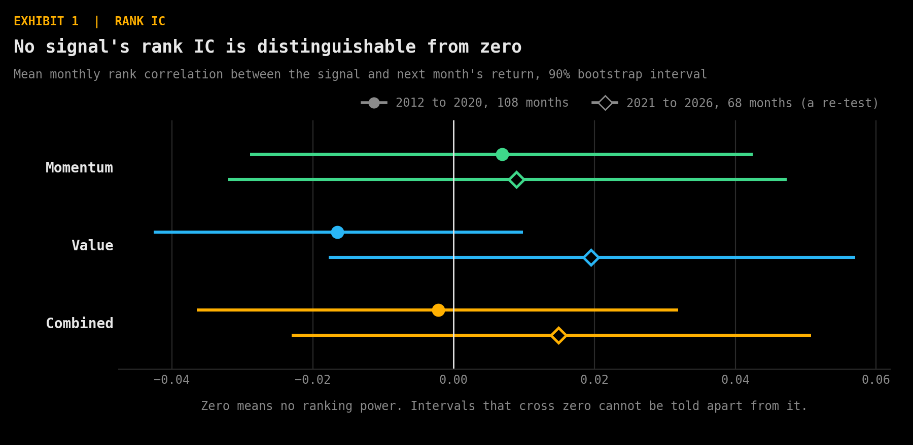
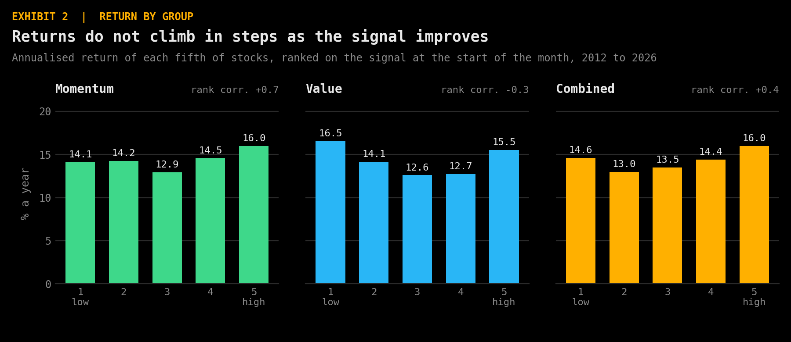
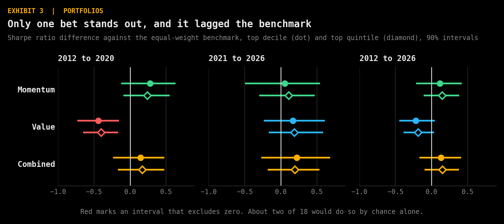

# Do Momentum and Value Still Work in the S&P 500?

[](https://github.com/ronaldoexmachina13/quant-equity-research/actions/workflows/tests.yml)

**Short answer: not detectably.** This is a pre-registered test of two of the best-known stock factors, 12-1 momentum and price-to-book value, and their average, on about 500 large US companies from January 2012 to August 2026. None of them ranks next-month returns better than chance. The study is built so that this is a credible answer and not a bug.

[**Open the dashboard**](https://ronaldoexmachina13.github.io/quant-equity-research/) &nbsp;|&nbsp; [Method and pre-registration](docs/LIMITATIONS_PLAN.md)



## Findings

| Question | Answer |
|---|---|
| **Do the rankings predict returns?** | No. None of 33 signal tests (3 signals, 4 kinds of test, 3 periods) excludes zero, whichever of three methods builds the interval. |
| **Do the top-ranked portfolios beat the benchmark?** | Not reliably. 2 of 18 Sharpe comparisons exclude zero. Both are Value in 2012 to 2020, both are the same bet, and the bet lagged the benchmark. Chance alone gives about 1.8. |
| **Could the test have found an effect?** | Only a fairly large one. With 108 months it detects a mean rank IC of about 0.055 (80% power). Smaller effects would be missed, so this is "no evidence of an effect", not "proof of no effect". |
| **Is the data good enough?** | For comparing strategies, yes. For return levels, no. The data are free and survivor-biased: names later dropped from the index earned about 3% to 4% a year in this sample, against about 16% for names that stayed. |

## Why a null result is worth reporting

Published factors often weaken when tested carefully. Hou, Xue and Zhang re-tested 447 published anomalies with methods that limit the weight of tiny stocks and found that 286 of them (64%) were statistically insignificant at the 5% level ([summary](https://alphaarchitect.com/replicating-anomalies/)). Large, liquid stocks such as the S&P 500 are a hard place to find a premium, so a null here is a plausible and informative outcome. What matters is whether the test was honest enough to be believed.



If a signal worked, the five groups would earn more in steps from left to right. Momentum's top group is the best in every period, but the groups below it are not ordered, and Value's pattern is not monotonic at all.



The one interval that stands out is Value in 2012 to 2020, measured twice (top decile and top quintile). It is absent from the re-test and from the full period, it points the wrong way for a value premium, and the tests of the signal itself for the same period all include zero (the Fama-MacBeth slope falls just below zero under three secondary sensitivities, which share the same months and stocks). Costs of 10 bps one way change none of these readings. No explanation has been tested.

The 2021 to 2026 months were already known from an earlier 17-stock study, so they are a re-test and not out-of-sample evidence.

## How the study avoids fooling itself

- **Pre-registered.** The design, the reading rules and every later change are dated, append-only amendments in [`docs/LIMITATIONS_PLAN.md`](docs/LIMITATIONS_PLAN.md), committed before the code that depends on them. Post-hoc additions are labelled as such.
- **No look-ahead.** A signal dated t uses data up to the end of month t-1 and is paired with the return in month t. Book values enter on the date the filing became public.
- **No tuning.** Signal definitions were frozen from the earlier study. No lookback, weight or threshold was varied to improve a result.
- **Honest intervals.** 90% bootstrap intervals, re-checked with Newey-West errors and a block bootstrap. Every test is counted, and the expected number of false alarms is stated.
- **It found and fixed its own errors.** A split-adjustment bug had flattered Value (17-stock Sharpe fell from 0.86 to about 0.61 once fixed), and unit errors in SEC share counts had produced absurd price-to-book ratios. Both are logged below.
- **Tested and reproducible.** About 330 unit tests with hand-worked cases run on every push. Seeds are fixed, and the raw-data cache is checksummed in `results/data_manifest.csv`.

## Limits

- **Survivorship.** Acquired and bankrupt companies mostly lack free price history. A delisting-aware source such as CRSP is the real fix.
- **Data quality.** Wikipedia membership is approximate early on, and some book values rest on share counts that may carry unit errors the rule cannot detect.
- **Scope.** Large caps only. P/B is not sector-adjusted, Momentum is not volatility-scaled, there is no quality factor, costs are a flat 10 bps one way, and there are no Fama-French controls.
- **Power.** The test cannot rule out a small premium.

## Explore

| Page | Question it answers |
|---|---|
| Summary | What is the answer, and why believe it? |
| Signals | Do the rankings predict next-month returns? |
| Portfolios | Do top-ranked stocks beat the benchmark? |
| Holdings | Which names drove the results? |
| Data | Can the data be trusted? |
| Method | What was done, in what order? |

<details>
<summary><b>Hypotheses and method</b></summary>

Momentum is the trailing 12-month return excluding the most recent month, which avoids the one-month reversal effect. Candidate explanations in the literature are slow incorporation of news and investor under-reaction. Value is the negative price-to-book ratio, which may compensate for distress risk or reflect over-pessimism. Neither premium is expected to be large among liquid, heavily analysed large caps, so a null result is a plausible outcome. Combined is the average of the two cross-sectional z-scores, with the 50/50 weighting fixed before testing.

1. **Timing.** A signal dated t uses data up to the end of month t-1 and is paired with the return in month t.
2. **Primary evidence.** Rank IC, quintile spread and Fama-MacBeth slopes (single and joint), each with a bootstrap interval.
3. **Secondary evidence.** Top-decile and top-quintile portfolios, with a paired bootstrap interval for each Sharpe difference. A difference counts only if the 90% interval excludes zero, and portfolio results are read alongside the signal tests.
4. **No tuning.** Signal definitions were frozen from the earlier study. No lookback, weight or threshold was varied.

**Pre-registration.** The design, the reading rules and every later change are recorded as dated, append-only amendments in [`docs/LIMITATIONS_PLAN.md`](docs/LIMITATIONS_PLAN.md), committed before the code that depends on them. The earlier study's out-of-sample test follows [`docs/OUT_OF_SAMPLE_PLAN.md`](docs/OUT_OF_SAMPLE_PLAN.md).

**Power.** The monthly rank IC has a standard deviation of up to about 0.23. With 108 months the minimum detectable mean IC is about 0.055, above the 0.02 to 0.03 often cited for large-cap momentum. The test could not have found a small real effect, so an interval that includes zero does not show the effect is zero.

</details>

<details>
<summary><b>Data</b></summary>

| Item | Source and treatment |
|---|---|
| Universe | S&P 500 membership rebuilt month by month from Wikipedia. Between 353 and 499 names are usable for Momentum each month and between 295 and 426 for Value and Combined. |
| Prices | Yahoo Finance via `yfinance`, adjusted close. |
| Book value | SEC EDGAR filings, aligned to the filing date. Book value per share is restated for later splits. |
| Risk-free rate | Three-month Treasury bill, FRED. |

**Survivorship.** Acquired and bankrupt companies mostly have no free price history, so each month's universe is the set of names that have data. In 2012, for Value and Combined, 26% of names later removed from the index had usable data against 85% of names that stayed. Names later removed that did have data earned an annualised mean monthly return of about 3% to 4% over 2012 to 2026, against about 16% for names that stayed. This is descriptive and not a correction.

</details>

<details>
<summary><b>Data integrity log</b></summary>

| When | Defect | Effect |
|---|---|---|
| Sep 2026 | Value used the month-end price instead of the previous month-end, a one-month look-ahead. | Raised the 17-stock Value Sharpe from 0.75 to 0.85, before the split fix below. The bug had penalised Value. |
| Sep 2026 | The first download missed 31 December 2024, because the `yfinance` end date is exclusive. | About 0.01 of Sharpe. |
| Oct 2026 | Price-to-book was too low for stocks that split their shares (Walmart 2024, NextEra 2020): Yahoo rewrites old prices after a split and SEC book value per share does not change. | 17-stock in-sample Value Sharpe fell from 0.86 to about 0.61, below the benchmark's 0.81. Alpha moved from +2.9% (t = 0.62) to about -0.9% (t = -0.17). Out-of-sample results are essentially unchanged. See `results/value_split_*.csv` and Amendment 8. |
| Oct 2026 | Some SEC filings report share counts under two tags that differ by more than 100 times (177 tag pairs in 155 filings), giving absurd price-to-book ratios. | Such filings carry no book value. Results were also run with winsorised P/B and with 24 and 37 names excluded. |

</details>

<details>
<summary><b>Reproducing the results</b></summary>

Python 3.13 and the pinned packages (`pip install -r requirements.txt`). Raw downloads are cached outside Git in the folder named by the environment variable `UNIVERSE_CACHE_DIR`. The SQLite file `database/universe_feasibility.db` is not committed. `results/data_manifest.csv` lists the size and SHA-256 checksum of every cached download (`make_data_manifest --verify` compares). Result files are never overwritten: each script stops if its output exists, and the committed `results/` files already exist in a fresh clone. Run everything from the repository root, as modules.

```bash
python -m scripts.universe.run_universe_membership      # S&P 500 membership from Wikipedia (database only)
python -m scripts.universe.run_universe_prices          # price availability, Yahoo Finance
python -m scripts.universe.run_universe_fundamentals    # book value availability, SEC EDGAR
python -m scripts.universe.rebuild_feasibility_db       # finishes the database, checks it against committed files
python -m scripts.universe.run_universe_splits          # split history for book value restatement
python -m scripts.universe.run_universe_gates           # reproduction gates (prints checks, writes no result file)
python -m scripts.universe.run_universe_signals --momentum-only
python -m scripts.universe.run_universe_signals --value-combined
python -m scripts.universe.run_universe_spy             # SPY reference prices
python -m scripts.universe.run_universe_portfolios      # portfolio tests and sensitivities
python -m scripts.universe.run_universe_extras          # quintile returns and Newey-West and block-bootstrap intervals (Amendment 14)
python -m scripts.universe.make_data_manifest           # checksums of the raw-data cache; add --verify to compare later
python -m scripts.universe.make_universe_charts         # the charts and table on this page
python -m scripts.universe.run_universe_holdings        # holdings and per-stock summary, checked against committed returns
python -m scripts.universe.generate_universe_dashboard_data   # assets/universe_*_data.js (never overwrites)
python -m pytest tests/ -q                              # about 330 tests, no network needed
```

Rerunning a result-writing script in a fresh clone stops at the first existing file. To regenerate a result, write it to a new folder or move the old file first.

</details>

<details>
<summary><b>Repository layout</b></summary>

```
index.html, signals.html, portfolios.html, holdings.html, data.html, method.html
                              dashboard pages (GitHub Pages serves the repository root)
assets/                       dashboard.js, styles.css and the generated universe_*_data.js files
config.py                     17-stock universe and evaluation windows (earlier study)
src/                          library code: data loading, SQLite storage, factors, backtest, risk, universe
                              construction, book value rules, split adjustment, signal evaluation, portfolios, data manifest
scripts/universe/             the large-universe pipeline, one script per stage (see Reproducing)
scripts/first_study/          the 17-stock study and its sensitivities
tests/                        unit tests checked against hand-worked cases, run on every push
sql/                          schema and analytical queries (see sql/README.md)
results/                      every generated CSV, JSON and chart (universe_* is the 500-stock study)
docs/                         pre-registration, out-of-sample plan, and the 17-stock write-up
database/                     SQLite files, generated and not committed
CLAUDE.md                     standing rules for the AI coding assistant used on this project
```

</details>

<details>
<summary><b>Earlier study: 17 stocks</b></summary>

A fixed set of 17 large caps, tested in sample (2021 to 2024) and on 20 pre-registered months it had not seen (January 2025 to August 2026). The benchmark had the highest out-of-sample Sharpe ratio (1.89, against 1.72 for Combined, 1.53 for Value and 1.05 for Momentum) and no strategy could be statistically distinguished from it. Value's in-sample edge does not survive the split correction. The write-up is in [`docs/STUDY_17_STOCKS.md`](docs/STUDY_17_STOCKS.md).

</details>

## Next steps

A delisting-aware data source, a delisting-return sensitivity, a Fama-French factor regression, sector-neutral Value and a quality factor.
